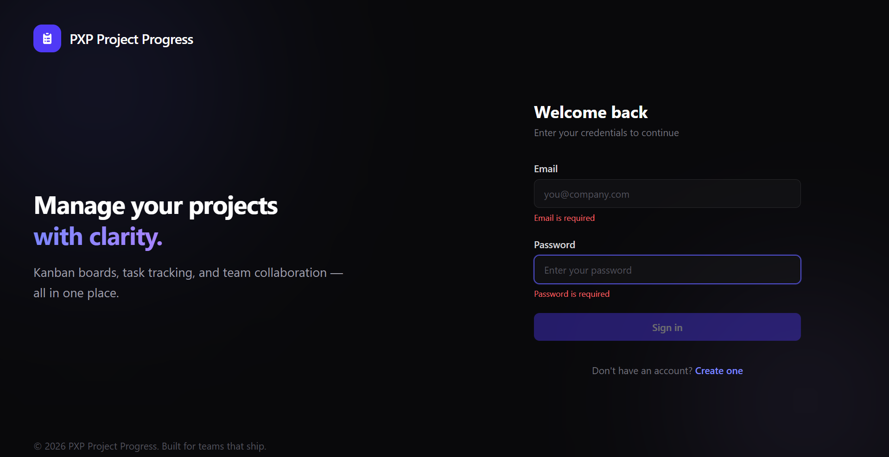
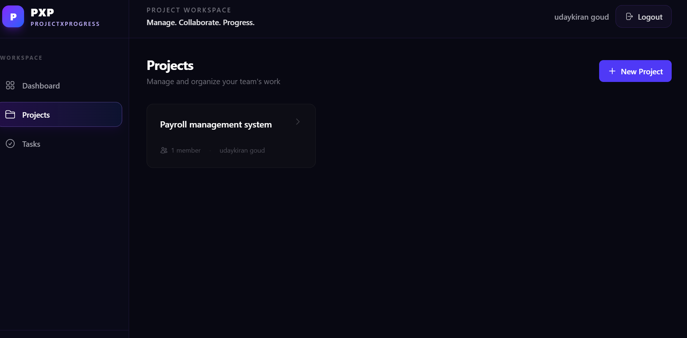
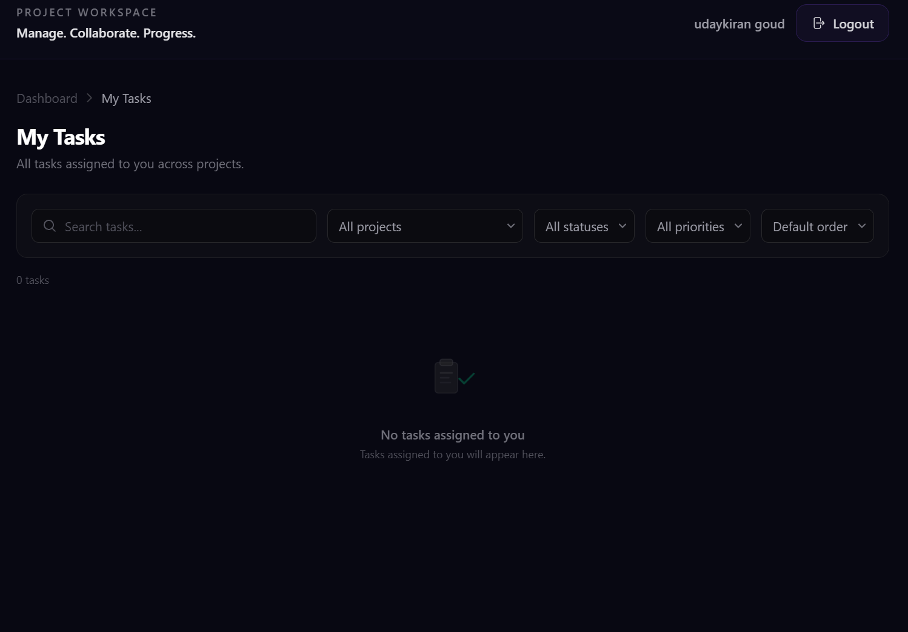

# PXP – ProjectXProgress

**A Full-Stack Project Management Platform**

PXP (ProjectXProgress) is a full-stack project management application designed to help teams organize projects, collaborate efficiently, manage tasks, and track progress through an interactive dashboard and Kanban board.

Built using Angular 21, Spring Boot 3, and PostgreSQL.


---

## About the Project

PXP provides a centralized platform for managing projects and team activities. Users can create projects, invite team members, assign tasks, set priorities and deadlines, and monitor project progress.

The application includes secure authentication, role-based access, task management, project analytics, and a responsive user interface.

## Key Features

- **Authentication:** Secure registration and login using JWT access and refresh tokens.
- **Project Management:** Create, update, and manage projects.
- **Team Collaboration:** Invite members and manage project access.
- **Kanban Board:** Organize tasks into To Do, In Progress, and Done columns.
- **Task Management:** Create, assign, update, and delete tasks.
- **Task Filtering:** Filter and search tasks by project, status, priority, and assignee.
- **Dashboard:** View project statistics, task progress, overdue tasks, and recent activity.
- **Role-Based Access:** Owner and member permissions.
- **API Documentation:** Interactive Swagger UI.
- **Responsive Design:** Supports desktop, tablet, and mobile screens.

---

## Screenshots

### Dashboard


### Login


### Projects


### Tasks


---
## Technology Stack

| Layer | Technology |
|---|---|
| Frontend | Angular 21, TypeScript |
| Styling | Tailwind CSS 4 |
| Backend | Java 17, Spring Boot 3 |
| Security | Spring Security, JWT, BCrypt |
| Database | PostgreSQL 16 |
| ORM | Spring Data JPA, Hibernate |
| API Documentation | SpringDoc OpenAPI, Swagger UI |
| Testing | Vitest, JUnit 5, Mockito |
| CI/CD | GitHub Actions |
| Containerization | Docker, Docker Compose |

---

## Application Architecture

```text
+---------------------+
|                     |
|    Angular 21       |
|    Frontend         |
|                     |
+----------+----------+
           |
           | HTTP / REST API
           |
+----------v----------+
|                     |
|    Spring Boot 3    |
|    Backend API      |
|                     |
|  Spring Security    |
|  JWT Authentication|
|  Business Logic     |
|                     |
+----------+----------+
           |
           | JPA / Hibernate
           |
+----------v----------+
|                     |
|    PostgreSQL 16    |
|    Database         |
|                     |
+---------------------+
```

## Project Structure

```text
PXP-project-progress/
|
|-- backend/
|   |-- src/main/java/com/trackr/
|   |   |-- config/
|   |   |-- controller/
|   |   |-- dto/
|   |   |-- exception/
|   |   |-- model/
|   |   |-- repository/
|   |   |-- security/
|   |   |-- service/
|   |
|   |-- src/main/resources/
|   |-- Dockerfile
|   |-- pom.xml
|
|-- frontend/
|   |-- src/app/
|   |   |-- core/
|   |   |-- features/
|   |   |   |-- auth/
|   |   |   |-- dashboard/
|   |   |   |-- projects/
|   |   |   |-- tasks/
|   |   |-- shared/
|   |
|   |-- src/environments/
|   |-- Dockerfile
|   |-- nginx.conf
|
|-- docs/
|   |-- screenshots/
|
|-- .github/
|   |-- workflows/
|       |-- ci.yml
|
|-- docker-compose.yml
|-- docker-compose.prod.yml
|-- .env.example
|-- README.md
```

*Note: The existing Java package is retained internally as `com.trackr`; this does not affect the PXP branding.*

---

## Getting Started

### Prerequisites

- Java 17
- Node.js and npm
- PostgreSQL 16
- Git
- Docker and Docker Compose (if using the containerized setup)

### 1. Clone the Repository

```bash
git clone https://github.com/udaye-gwd/PXP-project-progress.git
cd PXP-project-progress
```

### 2. Configure the Environment

Create your environment configuration using the example file:

```bash
cp .env.example .env
```

Configure the required database and authentication settings in `.env`.

### 3. Start the Backend

Navigate to the backend folder:

```bash
cd backend
```

Run the Spring Boot application using the development profile:

```bash
./mvnw spring-boot:run -Dspring-boot.run.profiles=dev
```

On Windows PowerShell:

```powershell
.\mvnw.cmd spring-boot:run "-Dspring-boot.run.profiles=dev"
```

Backend URL:

`http://localhost:8080`

### 4. Start the Frontend

Open another terminal:

```bash
cd frontend
npm install
npm start
```

Frontend URL:

`http://localhost:4200`

### 5. API Documentation

Once the backend is running, access Swagger UI:

`http://localhost:8080/swagger-ui/index.html`

---

## Demo Login Credentials

The development database includes the following test accounts:

| Email | Password | Role |
|---|---|---|
| admin@trackr.dev | password123 | Admin |
| alice@trackr.dev | password123 | Member |
| bob@trackr.dev | password123 | Member |

*These are development test credentials. Do not use them in production.*

---

## API Endpoints

| Method | Endpoint | Description |
|---|---|---|
| GET | `/api/health` | Health check |
| POST | `/api/auth/register` | Register a user |
| POST | `/api/auth/login` | Authenticate a user |
| POST | `/api/auth/refresh` | Refresh access token |
| GET | `/api/dashboard` | Dashboard statistics |
| GET | `/api/projects` | List projects |
| POST | `/api/projects` | Create a project |
| GET | `/api/projects/:id` | Get project details |
| PUT | `/api/projects/:id` | Update a project |
| DELETE | `/api/projects/:id` | Delete a project |
| GET | `/api/projects/:id/members` | List project members |
| POST | `/api/projects/:id/members` | Add a project member |
| GET | `/api/tasks/me` | Get assigned tasks |
| POST | `/api/tasks` | Create a task |
| PUT | `/api/tasks/:id` | Update a task |
| PATCH | `/api/tasks/:id/status` | Update task status |
| DELETE | `/api/tasks/:id` | Delete a task |

---

## Testing

### Backend Tests

```bash
cd backend
./mvnw test
```

### Frontend Tests

```bash
cd frontend
npm test
```

The project also uses GitHub Actions for automated CI checks.

---

## Environment Variables

| Variable | Description |
|---|---|
| `POSTGRES_DB` | PostgreSQL database name |
| `POSTGRES_USER` | Database username |
| `POSTGRES_PASSWORD` | Database password |
| `JWT_SECRET` | JWT signing secret |
| `JWT_ACCESS_EXPIRATION` | Access token expiration |
| `JWT_REFRESH_EXPIRATION` | Refresh token expiration |
| `CORS_ALLOWED_ORIGINS` | Allowed frontend origins |

Refer to `.env.example` for the environment configuration.

---

## Future Improvements

- Real-time notifications
- Advanced project analytics
- Improved team collaboration
- File attachments for tasks
- Enhanced activity tracking
- Additional dashboard insights

---

## Author

**Uday Kiran**

GitHub: [udaye-gwd](https://github.com/udaye-gwd)

Project Repository: [PXP – ProjectXProgress](https://github.com/udaye-gwd/PXP-project-progress)

---

## License

This project is developed for portfolio, educational, and learning purposes.